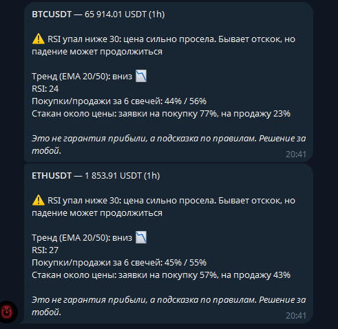

# Crypto Signal Bot: уведомления о рынке Binance в Telegram

Бот следит за криптовалютными парами на Binance и присылает уведомление в Telegram, когда разворачивается тренд или цена резко уходит в перекупленность или перепроданность. Работает в облаке **GitHub Actions**, поэтому не нужен сервер и нет абонентской платы.

**Бот не торгует** и не требует ключей от биржи: он берёт только открытые рыночные данные.

## Возможности

- Мониторинг любого списка пар Binance по расписанию (по умолчанию раз в час)
- Индикаторы: тренд по EMA 20/50, RSI 14, перевес рыночных покупок и продаж, баланс стакана заявок
- Сообщения в Telegram **только при событии**, плюс отчёт по кнопке «Run workflow»
- **Бэктест** стратегии на истории с учётом комиссий и сравнение с «купил и держал»
- **Исследование стратегий** с проверкой на отложенном годе данных, на десятках монет
- Секреты хранятся в GitHub Secrets; при сбое запуск помечается ошибкой и приходит письмо

**Стек:** Python · Binance REST API · Telegram Bot API · GitHub Actions · pandas

## Пример уведомления

Реальные сообщения бота в Telegram:



## Что показало исследование

Все стратегии проверены честно: выбор по 2 годам истории, оценка на последнем годе, который в выборе не участвовал, с комиссией и проскальзыванием.

| | Результат |
|---|---|
| BTC и ETH, 7 вариантов стратегий | Ни один стабильно не обыграл «купил и держал» |
| 40 малых монет, «купил и держал» за 3 года | Медиана **−66%** (BTC **+81%**), 35 из 40 падали от пика больше чем на 80% |
| 40 малых монет, лучшая стратегия | Около 0% на проверочном годе: меньше потерь, но без заработка |

Вывод: бот полезен как **монитор рынка**, а не как «кнопка прибыли». Подробные таблицы смотри в **Actions → Research / Backtest → Summary**.

## Как это работает

| Что | Зачем |
|---|---|
| **EMA 20 и EMA 50** (скользящие средние) | Направление тренда. Пересечение означает разворот |
| **RSI 14** | Сильно ли цена упала (ниже 30) или выросла (выше 70) |
| **Поток сделок** | Кого больше за последние 6 часов: рыночных покупателей или продавцов |
| **Стакан заявок** | Где сейчас больше заявок около цены: на покупку или на продажу |

Все параметры задаются в `config.py`.

---

## Установка (≈15 минут, всё бесплатно)

### 1. Создай Telegram-бота
1. В Telegram найди **@BotFather**, отправь `/newbot`, придумай имя.
2. BotFather пришлёт **токен** вида `123456789:AAH...`. Сохрани его.

### 2. Узнай свой chat_id
1. Найди своего нового бота в Telegram и напиши ему любое сообщение.
2. Открой в браузере (вместо `ТОКЕН` вставь свой токен):
   `https://api.telegram.org/botТОКЕН/getUpdates`
3. Найди там `"chat":{"id":123456789`. Это число и есть **chat_id**.

### 3. Создай репозиторий на GitHub
1. GitHub → **New repository** → название, например `crypto-signal-bot` → выбери **Private** → **Create repository**.
2. **Add file → Upload files** → открой распакованную папку `crypto-signal-bot` и перетащи **всё, что внутри неё** (не саму папку!), **включая папку `.github`** → **Commit changes**. Файл `bot.py` должен лежать в корне репозитория, иначе GitHub не найдёт расписание.

> На macOS папка `.github` скрыта: в Finder нажми `Cmd + Shift + .`, чтобы её увидеть.
> Если после загрузки во вкладке **Actions** нет workflow, значит папка не загрузилась. Тогда создай файлы вручную: **Add file → Create new file**, в имени напиши `.github/workflows/signals.yml` и вставь содержимое. То же самое для `backtest.yml`.

### 4. Добавь секреты (токен нельзя класть в код!)
**Settings → Secrets and variables → Actions → New repository secret**:
- `TELEGRAM_TOKEN`: токен от BotFather
- `TELEGRAM_CHAT_ID`: твой chat_id

### 5. Проверь, что работает
**Actions → Crypto signals → Run workflow**. Через минуту в Telegram придёт отчёт по каждой паре.
Дальше бот будет запускаться сам каждый час и писать **только когда есть сигнал**.

### 6. Проверь стратегию на истории
**Actions → Backtest → Run workflow** → укажи число дней → открой запуск. Таблица будет на странице **Summary**: сколько заработала бы стратегия и сколько дало бы «купил и держал».

---

## Если ошибка 451

Binance блокирует запросы с серверов в некоторых странах (например, в США), а серверы GitHub часто находятся там. Бот сначала пробует `data-api.binance.vision`: это адрес Binance только для рыночных данных, и обычно он работает. Если всё равно 451, запусти бота на своём компьютере:

```bash
pip install -r requirements.txt
python bot.py --report      # отчёт в консоль
python backtest.py 180      # бэктест за 180 дней
```

Чтобы локальный бот писал в Telegram, задай переменные перед запуском:
- Windows (PowerShell): `$env:TELEGRAM_TOKEN="..."; $env:TELEGRAM_CHAT_ID="..."`
- macOS / Linux: `export TELEGRAM_TOKEN="..." TELEGRAM_CHAT_ID="..."`

## Лимиты GitHub
- В публичном репозитории запуски бесплатны без лимита минут. В приватном бесплатно 2000 минут в месяц, а бот тратит около минуты в час, это примерно 750 минут в месяц.
- В публичном репозитории GitHub отключает расписание, если 60 дней не было изменений. Включается обратно одной кнопкой во вкладке Actions.
- Запуски по расписанию GitHub иногда задерживает на несколько минут, а при большой нагрузке может пропустить.

## Безопасность
- Токены храни только в **Secrets**, никогда не вписывай их в файлы.
- Если когда-нибудь подключишь ключ Binance для торговли, у ключа **не должно быть права на вывод средств**.

## Файлы
- `config.py`: все настройки
- `core.py`: загрузка данных, индикаторы, правила сигналов
- `bot.py`: проверка сигналов и отправка в Telegram
- `backtest.py`: проверка стратегии на истории
- `tools/research.py`: исследование стратегий на многих монетах
- `tools/fetch_data.py`: выгрузка истории свечей
- `.github/workflows/`: расписание и ручные запуски на GitHub
